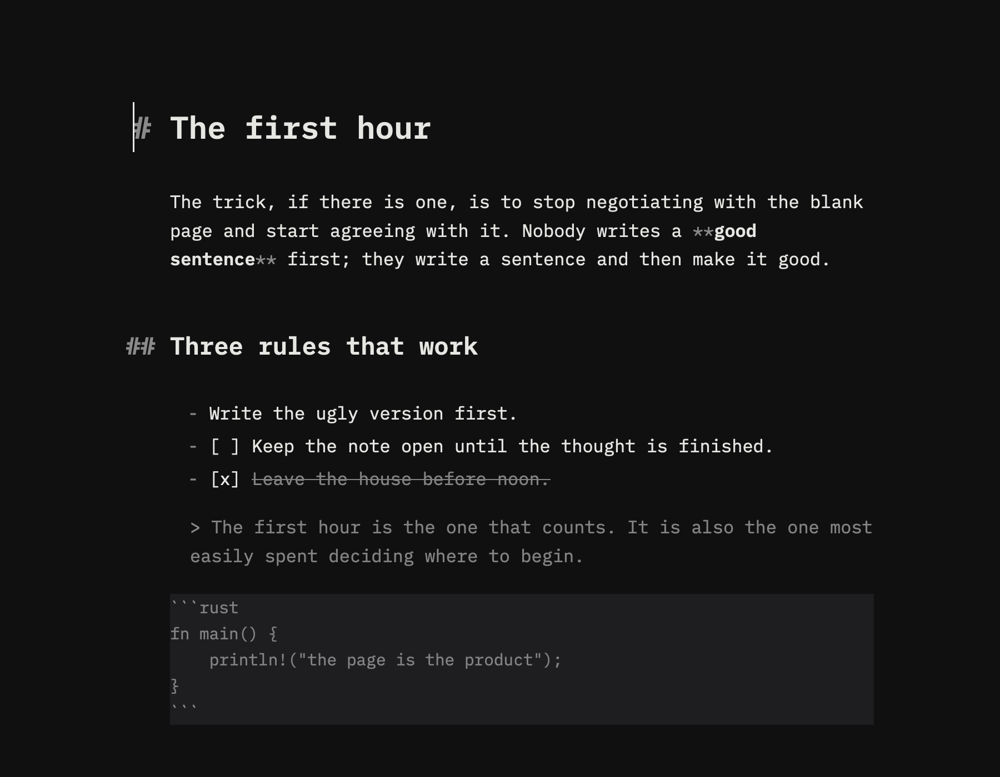

# Pilcrow



A local-first writing app for macOS, Linux, and Windows. One note per window,
plain Markdown files on disk, no account, no cloud, no sidebar, and nothing
between you and the sentence.

The application is the Rust workspace under `crates/`, built on GPUI.

## Quick start

Requirements: Rust 1.98 (the repository pins it in `rust-toolchain.toml`) and,
on Linux, the GPUI system libraries listed in `docs/DEVELOPMENT-GUIDE.md`.

```sh
cargo run -p pilcrow-app          # debug window
cargo test --workspace --locked   # all unit and GPUI tests
```

macOS bundle with the product name, icon, native About panel, and Markdown file
association:

```sh
scripts/bundle-macos.sh
open target/Pilcrow.app
```

Signing and notarization are deliberately off by default (`PILCROW_SIGN=0`).
No command in the normal build, test, CI, or CD path invokes `codesign` or
prompts for a keychain password. See `docs/RELEASE.md`.

## What it does

- **The page is the product.** A measured writing column set in bundled IBM
  Plex Mono, hanging Markdown markers, a size ladder for headings, tinted code,
  and quiet rules. Light, dark, system, and a true black/white high-contrast
  appearance are all solved for contrast.
- **Markdown is the file.** The buffer is the bytes on disk; blocks, inline
  styles, and visual lines are derived. There is no rich-text tree or hidden
  second document.
- **Typing stays immediate.** Layout is incremental and stays on the thread
  that paints the caret. A long paragraph rewraps from the edited visual line,
  block scans start at the changed neighborhood, stats compute off the UI
  thread after a pause, and spellcheck waits for idle.
- **Task lists are text.** `[ ]` and `[x]` remain visible, selectable source
  text; clicking the marker toggles the `X`, and completed body text is struck
  through.
- **Find and replace.** `⌘F`/`Ctrl+F` opens the in-note bar with highlighted
  matches, next/previous wrapping, case sensitivity, replace, and replace-all
  as one undo step.
- **Reading view.** `⌘R`/`Ctrl+R` shows a syntax-free display copy with page
  navigation; it is read-only.
- **Focus and typewriter modes.** Paragraph or sentence stays bright; the
  caret can be held at a stable vertical position.
- **Text size, measure, and contrast.** Five persisted text sizes,
  Narrow/Standard/Wide measures, and a High Contrast appearance, available
  from View.
- **Session and retrieval.** The last session's paths and view positions
  reopen; File → Open Recent remembers ten files; next/previous note cycling is
  available from the Window menu.
- **Durability.** Untitled notes write atomic drafts, titled notes autosave with
  bounded idle/max timers, external edits produce an explicit Reload/Save As/
  Overwrite choice, and successful saves create rolling local backups.
- **Safe files.** Reads are bounded, writes are checked against the exact disk
  version, replacement is atomic where the OS supports it, and unreadable or
  oversized files are refused rather than silently replaced.
- **Spellcheck.** On macOS the system dictionary marks prose after a typing
  pause; code, fences, and link URLs are filtered out.
- **Export.** Standalone HTML export and Copy as HTML from the same block and
  inline model.
- **Accessibility.** The page publishes a `MultilineTextInput` role, text run,
  value, caret/selection, and SetTextSelection/ReplaceSelectedText/SetValue
  actions. CI includes a real xa11y gate on Linux X11.
- **Native shell.** Keyboard-first menus and shortcuts, standard macOS
  Hide/Hide Others/Show All roles, Open With/argv/file URL and drag-drop
  routing, a `Pilcrow` app bundle, native About panel, and unsigned release
  artifacts.

## Architecture

The short version:

```text
pilcrow-app ──▶ pilcrow-editor ──▶ pilcrow-core
     │                │                  ▲
     ├──▶ pilcrow-commands               │
     └──▶ pilcrow-ui ────────────────────┘
```

`pilcrow-core` has no GPUI dependency. `pilcrow-editor` owns the writing page,
layout, input, find/reading, spellcheck, and accessibility. `pilcrow-app` owns
windows, files, saves, drafts, session, backups, preferences, menus, and the
native identity. `pilcrow-commands` owns the one action/keymap/menu vocabulary.

Full diagrams and invariants: **`docs/ARCHITECTURE-GPUI.md`**.

## Testing and CI

```sh
cargo test --workspace --locked
cargo test -p pilcrow-app --features test-driver --locked
./scripts/coverage.sh                       # 85% line gate
python -m pytest tests/e2e -q              # real-window smoke, if built
```

GitHub Actions:

- `.github/workflows/ci.yml` — format, clippy, tests, test-driver feature,
  coverage, Linux real-window E2E plus accessibility, macOS E2E best effort,
  and Windows compile best effort.
- `.github/workflows/nightly.yml` — scheduled real-window E2E, crash
  recovery, accessibility, and long-note perf filters.
- `.github/workflows/release.yml` — tag/manual unsigned macOS `.app`,
  Linux `.tar.gz`, Windows `.zip`, checksums, and a GitHub Release.

Current local baseline: **495 tests**, **87.0% line coverage**, clippy and fmt
clean. The testing contract is `docs/TESTING.md`.

## Documentation

| Document | Purpose |
|---|---|
| `docs/DEVELOPMENT-GUIDE.md` | setup, commands, code map, adding features, troubleshooting |
| `docs/ARCHITECTURE-GPUI.md` | current module, runtime, save, and persistence diagrams |
| `docs/TESTING.md` | test layers, E2E harness, coverage gate, release validation |
| `docs/RELEASE.md` | unsigned bundle/package policy and release steps |
| `docs/GPUI-VERSION.md` | pinned GPUI commit and upgrade policy |
| `tests/e2e/README.md` | real-window harness, artifacts, and permissions |

## Deliberate non-goals

- Tabs, a persistent sidebar, or a file tree in the writing window.
- Sync services, accounts, collaboration, or required background services.
- Plugins or a public extension API.
- AI generation or suggestions while typing.
- A theme editor, custom font gallery, or per-document typography system.
- Print/PDF/DOCX typesetting pipelines.
- Data migration or a compatibility layer for earlier builds.
- Reading or modifying data outside the app's own root.

## License

MIT. See `LICENSE`.
