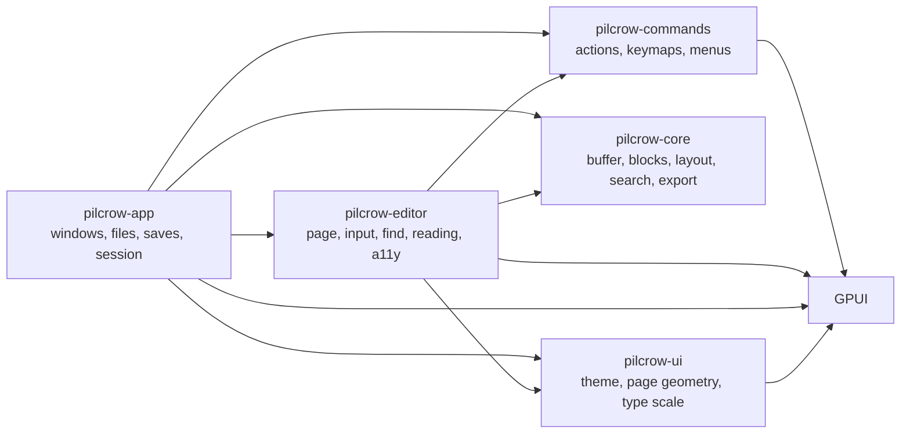
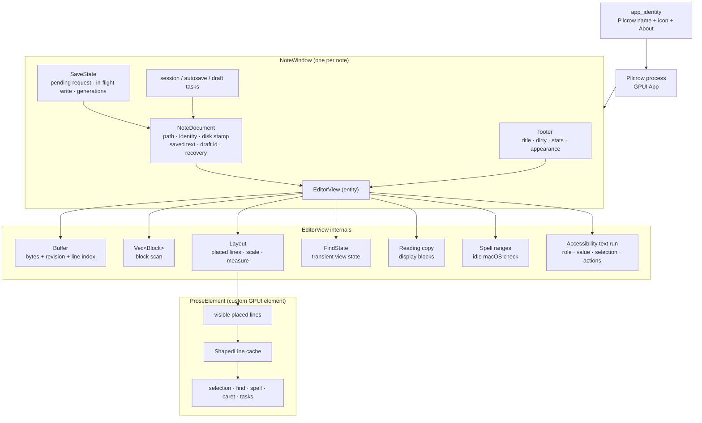
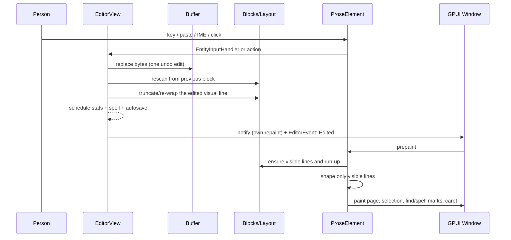
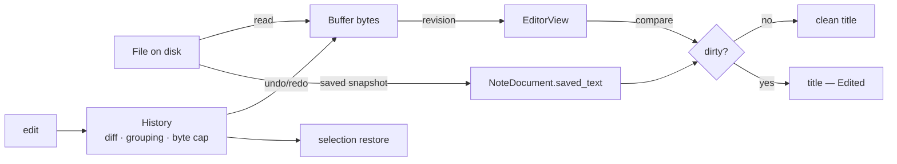
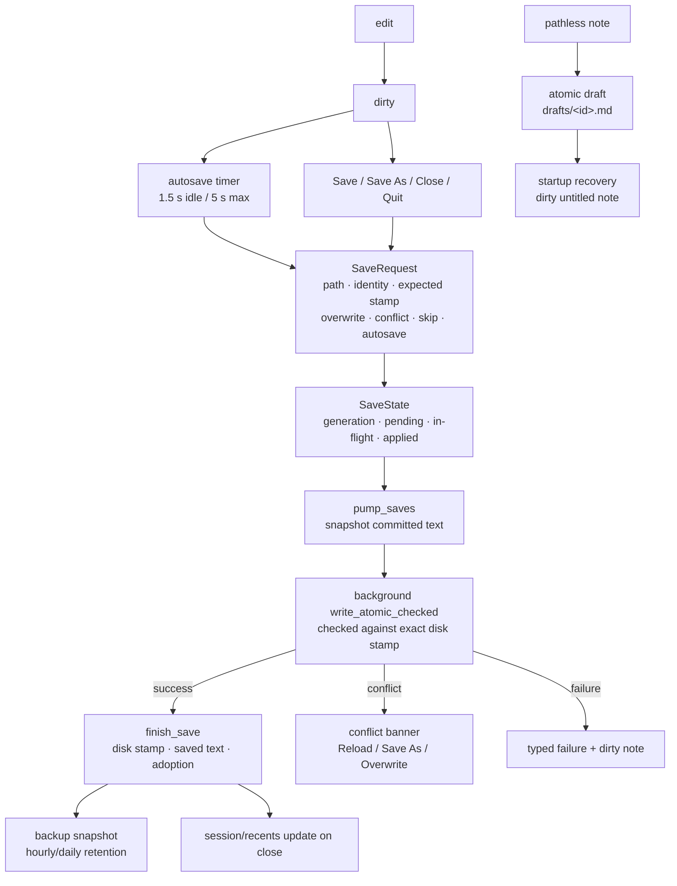
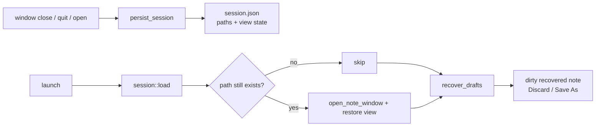
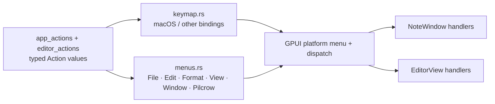

# Pilcrow GPUI architecture

**Status:** current

**Updated:** 2026-11-08

**Scope:** the Rust/GPUI app in `crates/`.

This document is the map. `docs/DEVELOPMENT-GUIDE.md` is the working manual:
setup, commands, tests, and how to change each layer safely.

---

## 1. The shape in one picture



Dependency direction is deliberate:

- `pilcrow-core` is pure Rust. It can be tested with a fake measurer and no
  display.
- `pilcrow-editor` knows text, layout, input, and GPUI. It does not know about
  files, sessions, or drafts.
- `pilcrow-app` knows disk, windows, persistence, native identity, and policy.
- `pilcrow-commands` has one action vocabulary, one keymap model, and one menu
  model so the app and editor cannot fork namespaces.

---

## 2. Runtime object graph



The `NoteWindow` is not a second copy of the document. `NoteDocument` stores
only the disk identity and the last text known to be on disk. The live bytes,
caret, history, blocks, layout, and modes are in `EditorView`.

`find`, `reading`, and `spell` are view state. They never enter the document,
history, or autosave payload.

---

## 3. The typing frame



Rules this frame enforces:

- **The buffer is the file.** There is no rich-text representation to sync.
- **The caret is exact in the frame receiving the key.** Layout and shaping
  that affect the caret stay on the main thread.
- **Visible layout is incremental.** A text edit rescan starts near the edit
  and stops at the first blank line past it where the block table
  resynchronises with the previous scan; a paragraph re-wraps from the edited
  visual line when its shape allows.
- **Jumps seed from an estimated height prefix.** `Layout` keeps per-block
  heights — exact once placed, estimated from block metadata before.
  A caret or scroll far outside the placed window reseeds placement at its
  estimated top and places the neighborhood exactly, so Cmd+End in a
  million-word note paints in one frame; only the skipped prefix's
  contribution to absolute y is approximate, never the caret or the lines
  on screen.
- **Only visible lines are shaped.** A cache keyed by block and line range
  keeps unchanged lines ready.
- **Nothing expensive starts synchronously from a keystroke.** Stats, spell
  checking, drafts, autosaves, and backups are delayed or dispatched.
- **The window hears typed events, not repaints.** `EditorEvent`
  (`Edited`, `SelectionChanged`, `StatsChanged`) is the only editor→window
  channel. Only `Edited` may schedule autosave/draft work; only the
  three events re-render the window chrome (title, dirty marker, footer
  stats). Scrolls, spell results, and find-bar state repaint inside the
  editor alone. The editor owns the bytes and view state, the window owns
  file identity, and `EditorSnapshot`/`view_state` are the capture points
  where they meet.

---

## 4. Document, dirty, and undo



- Dirty is a content comparison against `NoteDocument.saved_text`, not just a
  revision. Undoing back to the saved text is clean. The buffer's incremental
  per-line content hash answers "changed" without a scan; bytes are compared
  only to confirm "unchanged", so the comparison stays exact.
- Undo is app-owned. Each edit records a bounded diff, a group, and selection
  state; formatting and task toggles restore the expected selection on redo.
- IME commit/cancel is one undo transaction; the preedit lives in the document
  so it wraps like real text.

---

## 5. Save, autosave, drafts, backups



Details that matter:

- A write is bound to the exact disk version observed by the caller. A
  metadata-only `touch` with identical bytes does not conflict.
- A successful write refreshes any queued save's expected stamp so a second
  explicit Save cannot false-conflict with the app's own bytes.
- Save As reserves its destination before the write; another window cannot
  adopt the same path concurrently.
- One pending request per note is deliberate. A request
  carries no text — `pump_saves` snapshots when the write starts — so
  replacing a pending request cannot lose words. The intent-loss cases are
  handled where they arise: autosave bails over a pending request, a
  conflict, or an adoption; a plain Save during adoption retargets via
  `save_after_adopt`; a replaced pending adoption releases its
  reservation; close waits for the pending write and quit flushes it. The
  full reasoning lives on `SaveState` in `crates/pilcrow-app/src/save.rs`.
- Quit writes the recovery journal for every dirty note before GPUI clears
  the window list. The stamp check, wait for any in-flight save, and final
  target write run on a dedicated thread, so a slow volume cannot block the
  foreground for the five seconds the old path allowed. GPUI gives that
  thread its 200 ms shutdown window; a save that has not drained by 180 ms
  keeps the journal instead of racing the final write.
- Writes are atomic where possible. Unsupported volumes fall back to a checked
  rename rather than blocking every save. On Windows there is no atomic
  exchange, so the fallback is a stamp check followed by a plain rename: the
  conflict guarantee is best effort there, matching the platform's support
  level, and the parent directory is not synced.
- Temp files are private and scavenged. On Unix a temp is created
  0600 with any inherited ACL cleared, and the note's own metadata is
  copied back only after the rename lands, so a crash can strand at most
  a private file. Stranded temps (`.pilcrow-tmp-{pid}-{seed}`) are
  removed at startup and on note read as soon as the writing process is
  gone, or after a day when liveness cannot be judged. No completed-temp
  markers: the rename is the commit, the vulnerable window between
  `sync_all` and rename is sub-millisecond, and drafts/autosaves already
  hold the same bytes, so a stranded temp is never the only copy.
  Windows has no ACL clearing yet, by decision: temps inherit the note
  directory's DACL (the app data root lives in the per-user profile,
  whose default DACL is user-only), and a rename keeps the temp's
  descriptor, so a note whose file DACL was narrower than its directory
  could widen on save. Mirroring the Unix clear-and-copy-back via
  `GetNamedSecurityInfoW`/`SetNamedSecurityInfoW` is the recorded plan
  for when Windows support past best-effort gets a host to verify on;
  until then the gap is accepted and named here rather than papered
  over with untested FFI. Recovery and draft names carry pid +
  monotonic sequence + nanosecond stamps, so collisions need no UUID
  dependency.
- Every read is bounded: notes and drafts at the 64 MiB note limit, the
  session and preferences files at 1 MiB, and the backup dedupe read only
  when the size already matches. An oversized auxiliary file is refused or
  skipped, never loaded whole.
- Drafts are app-private and pathless notes recover as dirty untitled windows.
- Every save records a rolling local backup under the app data root, including
  the bytes being overwritten.
- No signing or network operation exists in this path.

---

## 6. App data root

```text
PilcrowNext/                     (macOS) ~/Library/Application Support/PilcrowNext
                                 (Linux) ~/.local/share/pilcrow-next
                                 (Windows) %APPDATA%\PilcrowNext
├── settings.json                appearance, text scale, measure
├── session.json                 last windows: paths, caret, anchor, scroll, modes, frames
├── drafts/
│   └── <draft-id>.md            atomic recovery copy for pathless notes
├── backups/
│   └── <note>-<path-hash>/
│       └── <timestamp>.md       rolling save history
└── recovery/                    quit-time last-resort copies
```

`PILCROW_DATA_DIR` overrides the root for tests and isolated runs. An empty
value is an error; it never silently falls back to the developer's real data.

The app never reads or modifies data outside its own root, with one
last-resort exception: if a quit-time recovery copy cannot be written under
the root, `write_recovery` cascades to the system temp directory, then a
sidecar next to the note, then the working directory. Saving the words
somewhere findable beats losing them; a note's own file is only ever written
through the checked save path.

---

## 7. Persistence and session flow



- Session restore stores paths and view state, never document text.
- Missing files are skipped.
- Duplicate session paths are deduped by canonical identity.
- Missing session paths still leave draft recovery available.
- Save As adopts a path and removes the corresponding draft.

---

## 8. Persistence safety and failure model

| Failure | Result |
|---|---|
| Draft write fails | Note stays dirty; next pause/quit retries. |
| Titled save fails | Note stays open and dirty with a typed error; old file untouched. |
| File changed underneath | Banner with Reload / Save As / Overwrite; autosave does not overwrite silently. |
| File deleted or replaced before clean close | Close verifies the disk; if changed, the window stays and asks for an explicit save. |
| Quit while a save is in flight | Journal first; bounded wait on a dedicated thread, then final checked write or the recovery copy. |
| Recovery file + target write fail | Optional clipboard fallback is opt-in only. |
| File over 64 MiB | Read/write is refused before allocation, with a clear error. |
| Temporary cleanup fails | Temp remains private (`0600`); startup scavenges stale temp siblings. |

---

## 9. Commands, menus, and keymaps



- `pilcrow-commands` owns the vocabulary and menu/keymap model.
- `pilcrow-app` installs shell handlers and the native app menu.
- `pilcrow-editor` installs editor handlers and editor keybindings.
- Menu labels and shortcuts therefore cannot drift from the actual actions.
- macOS adds the standard AppKit Hide/Hide Others/Show All responder actions
  to the app menu after GPUI's model is installed; those are platform roles,
  not typed app actions. They are removed and re-added on each rebuild so a
  menu refresh cannot duplicate them.

---

## 10. Accessibility

The page wrapper, not the custom paint element, owns the accessibility node:

- `Role::MultilineTextInput`
- full text value and one synthetic `TextRun`
- byte-accurate character lengths
- caret and selection as AccessKit positions
- `SetTextSelection`, `ReplaceSelectedText`, and `SetValue` actions

The accessibility tree is exercised by an opt-in real-window xa11y test. Linux
CI runs it under X11/AT-SPI; macOS is best effort because the runner needs TCC
permissions.

---

## 11. Threading model

| Work | Thread |
|---|---|
| Input, block scan, layout, shaping, paint, caret/selection | main |
| Read-on-open preparation and explicit file writes | background executor |
| Autosave, backups, drafts | background executor |
| Stats computation | background executor after a pause |
| macOS spellcheck | main, only after an idle pause, one ~32 KiB chunk per frame |
| Session write | close/quit, small JSON |
| Quit final flush | recovery journal/session on foreground; stamp check, save drain, and final writes on a dedicated thread, bounded to the shutdown window |

`SaveGuard` counts in-flight writes so the dedicated quit thread can wait for
them. It is poison-safe and deliberately process-global; the save state itself
is per note.

---

## 12. Module map

| Crate/module | Responsibility |
|---|---|
| `pilcrow-core/src/buffer.rs` | bytes, revisions, UTF-8 boundaries, line index |
| `pilcrow-core/src/blocks.rs` | block scanner: headings, lists, code, quotes, rules, frontmatter |
| `pilcrow-core/src/inline.rs` | emphasis, code, links, marker kinds |
| `pilcrow-core/src/wrap.rs` | run-aware line wrapping |
| `pilcrow-core/src/layout.rs` | placed lines, hangs, gaps, incremental frontier, estimated height prefix/jumps, text scale |
| `pilcrow-core/src/style.rs` | type scale and block spacing |
| `pilcrow-core/src/display.rs` | syntax-free reading copy |
| `pilcrow-core/src/search.rs` | literal search, smart case, range replacement |
| `pilcrow-core/src/export.rs` | standalone HTML |
| `pilcrow-core/src/history.rs` | bounded diff undo/redo and grouping |
| `pilcrow-core/src/stats.rs` | words, characters, CJK, reading time |
| `pilcrow-editor/src/api.rs` | the frozen editor surface: EditorView, EditorEvent, snapshots, trace, bundled font registration |
| `pilcrow-editor/src/lib.rs` | EditorView state, editing funnel, movement, geometry integration |
| `pilcrow-editor/src/paint.rs` | Render (find bar, reading page) + ProseElement prepaint/paint |
| `pilcrow-editor/src/input.rs` | EntityInputHandler: UTF-16 ranges, marked text, replacement |
| `pilcrow-editor/src/find.rs` | transient find-bar state |
| `pilcrow-editor/src/reading.rs` | reading page |
| `pilcrow-editor/src/a11y.rs` | AccessKit text run and metrics |
| `pilcrow-editor/src/spell.rs` | macOS system spellcheck + prose filtering |
| `pilcrow-app/src/lib.rs` | app lifecycle, NoteWindow, commands, render |
| `pilcrow-app/src/registry.rs` | canonical-path window registry/reservations |
| `pilcrow-app/src/save.rs` | SaveRequest/SaveState, SaveGuard, bounded quit wait |
| `pilcrow-app/src/file.rs` | bounded reads, digests, atomic/checked writes |
| `pilcrow-app/src/ffi.rs` | ACL/xattr capture, restore, and inherited-ACL clearing |
| `pilcrow-app/src/drafts.rs` | pathless note recovery |
| `pilcrow-app/src/backups.rs` | rolling local version history |
| `pilcrow-app/src/session.rs` | last session + recent files |
| `pilcrow-app/src/prefs.rs` | appearance, text size, measure |
| `pilcrow-app/src/app_identity.rs` | macOS name, icon, About panel, standard app-menu roles |
| `pilcrow-app/src/test_driver.rs` | feature-gated real-window driver |
| `pilcrow-commands/src/*` | actions, keymaps, menus |
| `pilcrow-ui/src/*` | tokens, type scale, page geometry |

---

## 13. Invariants

1. The buffer is the file; no second document representation.
2. Nothing animates or performs full-document work while typing.
3. The caret only sits on a UTF-8 boundary.
4. Caret and selection geometry come from the same `ShapedLine` that paints.
5. One visual line has one placed geometry; layout is incremental.
6. Dirty is content-based; success is the disk stamp returned by the write.
7. No external edit is silently overwritten.
8. No data outside the app's own root is read or modified, except the
   last-resort quit recovery cascade in §6.
9. No signing secret or network service is required to build or run.
10. A failed save leaves the old file intact and the note dirty.

---

## 14. Known constraints

- Windows temp files inherit the note directory's DACL until the
  clear-and-copy-back plan can be verified on a Windows host.
- The test driver's transport is a Unix socket; Windows needs a named pipe.
- The manual VoiceOver/Orca pass is still a release-candidate step.

The README is the product overview; `docs/DEVELOPMENT-GUIDE.md` is the working
manual.
